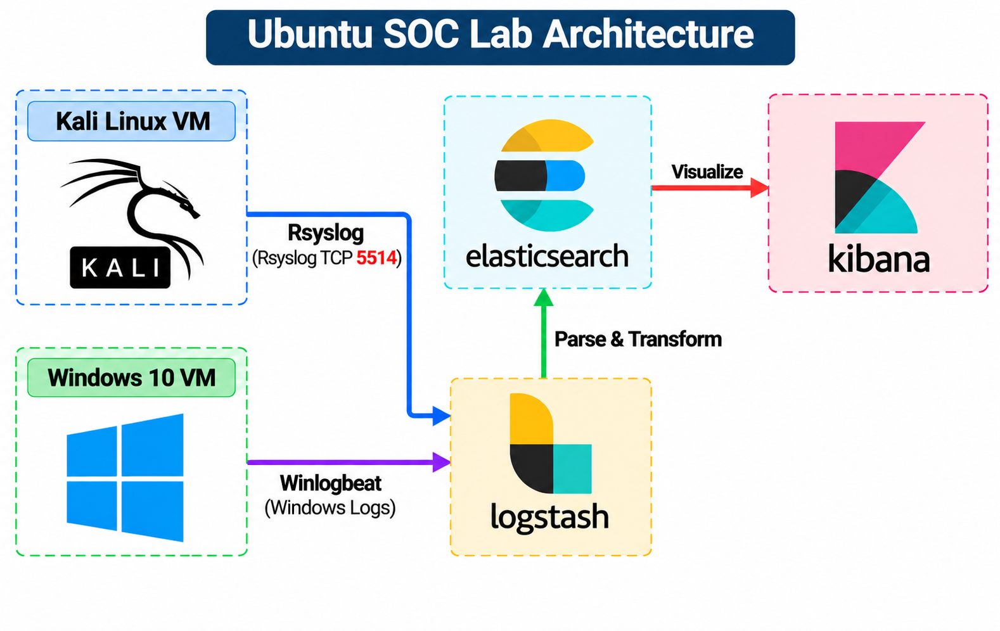

## ELK SOC Home Lab – Setup Guide

This document explains the setup, configuration, and log collection process of my ELK Stack SOC home lab.

## 1. Project Overview

This project implements a virtual Security Operations Center (SOC) environment using the ELK Stack (Elasticsearch, Logstash, and Kibana) to collect, process, store, and analyze security logs from Windows and Kali Linux virtual machines.

The lab was developed using Oracle VirtualBox, with Ubuntu Server hosting the ELK Stack.

## 2. Lab Environment

| Component | Technology |
|---|---|
| Virtualization | Oracle VirtualBox |
| SIEM Server | Ubuntu Server 24.04 |
| Linux Endpoint | Kali Linux |
| Windows Endpoint | Windows 10 VM |
| Log Processing | Logstash |
| Log Storage | Elasticsearch |
| Log Visualization | Kibana |
| Windows Log Forwarder | Winlogbeat |
| Linux Log Forwarder | rsyslog |

## 3. Network Configuration

The virtual lab uses a Host-Only network adapter for communication between virtual machines.

Ubuntu SOC Server IP: `192.168.56.103`

The lab uses the following network ports:

| Port | Service | Purpose |
|---|---|---|
| 5044/TCP | Logstash Beats Input | Windows log collection |
| 5514/TCP | Logstash Syslog Input | Kali Linux log collection |
| 9200 | Elasticsearch | Log storage and indexing |
| 5601 | Kibana | Web-based monitoring interface |

## 4. SOC Lab Architecture

### Windows Log Collection
- Installed Winlogbeat on the Windows virtual machine.
- Configured event collection for Application, System, Security, Sysmon, and PowerShell logs.
- Configured Winlogbeat to forward events to Logstash.
- Used TCP port 5044 for log forwarding.

### Kali Linux Log Collection
- Configured rsyslog on Kali Linux.
- Created a forwarding configuration using the `omfwd` module.
- Configured the destination IP as `192.168.56.103`.
- Forwarded logs to Logstash using TCP port 5514.

## 5. ELK Stack Configuration

### Elasticsearch
- Installed and configured Elasticsearch on Ubuntu Server.
- Used Elasticsearch to store and index incoming security logs.
- Configured HTTPS communication on port 9200.
- Used separate daily indexes for Windows and Kali Linux logs.

### Logstash
- Configured Beats input on TCP port 5044.
- Configured Syslog input on port 5514.
- Created filters to distinguish Windows and Kali Linux log sources.
- Added a custom `lab_source` field to identify the source of incoming events.
- Forwarded processed events to Elasticsearch using HTTPS.

### Kibana
- Configured Kibana for security event monitoring and investigation.
- Created separate data views for Kali Syslog and Winlogbeat.
- Used the Discover interface to search and examine collected events.
- Investigated Windows authentication events and Kali SSH activity.

## 6. Log Ingestion Workflow

1. Windows generates application, system, and security events.
2. Winlogbeat collects selected Windows events and forwards them to Logstash.
3. Kali Linux generates system and authentication logs.
4. rsyslog forwards Kali Linux logs to Logstash.
5. Logstash receives and processes incoming events.
6. Elasticsearch stores the processed logs in separate indexes.
7. Kibana provides an interface for searching, monitoring, and investigating security events.

## 7. Log Collection Validation

Log collection was verified through Kibana Discover.

- Kali Syslog data view displayed Linux system and authentication logs.
- Winlogbeat data view displayed Windows endpoint events.
- Failed SSH authentication events were identified.
- Successful SSH authentication events were identified.
- Windows event data was available for investigation.

## 8. Security Monitoring and Investigation

The lab was used to explore the following security scenarios:

- Windows successful login monitoring (Event ID 4624).
- Windows failed login monitoring (Event ID 4625).
- Kali Linux SSH failed-password activity.
- Kali Linux SSH successful authentication activity.
- Investigation of repeated failed authentication attempts followed by successful login.

## 9. Security Considerations

- Elasticsearch credentials should never be stored in public configuration files.
- Sensitive information must be removed before publishing configurations.
- TLS certificate verification was configured for Elasticsearch communication.
- The environment was developed for controlled virtual lab testing.

## 10. Learning Outcomes

- SIEM installation and configuration.
- Centralized Windows and Linux log collection.
- Log processing and indexing using Logstash.
- Security event investigation using Kibana.
- Authentication monitoring and basic threat detection.
- Understanding SIEM log ingestion pipelines.

## Disclaimer

This project was developed in a controlled virtual lab environment for educational and cybersecurity learning purposes.
